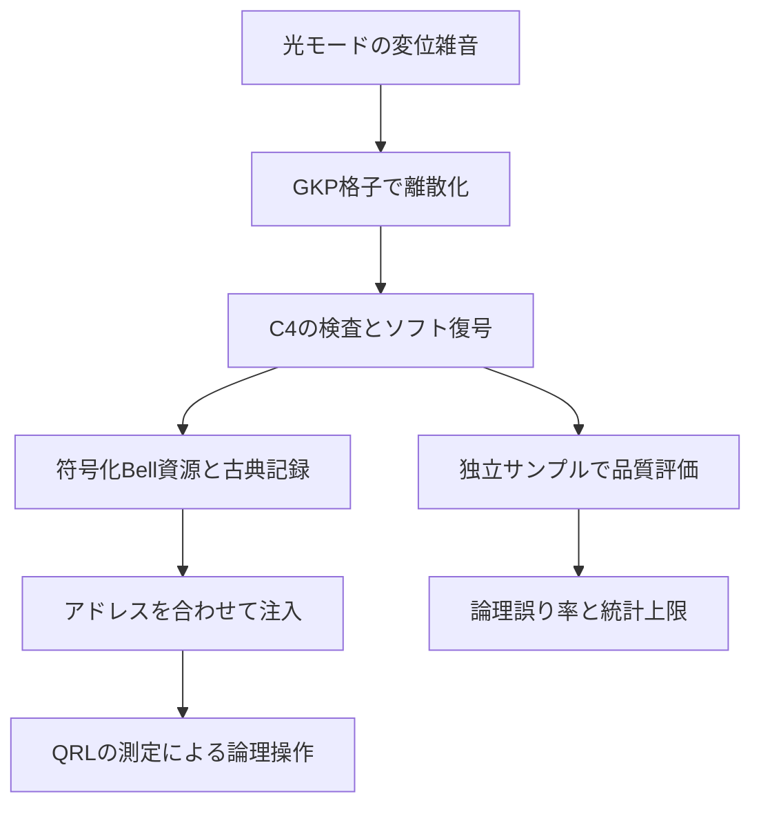

# 01 論文への見取り図

## この論文の問い

光で巨大な量子計算を行うには、誤りを抑えた量子状態を作る部分と、それを使って計算する部分をどう結びつければよいでしょうか。本論文はこの接続を、量子状態だけでなく、住所、測定の意味、補正履歴、信頼度を含む契約として定義します。

工場はよい符号化Bell資源を準備します。プロセッサは光クラスタを連続生成し、ホモダイン測定の基底を変えて計算します。使われる物理モードは時刻とともに変わるため、「この線にデータがある」という説明だけでは不足します。

![[fig1.png]]

原論文 Fig. 1。上下に資源を積み重ねる図は、並列幅を増やす発想です。すべてを順番に実行する回数が増える図とは読みません。並列容量が十分かは別に確認する必要があります。

## 三つの保護・処理の層

第1層は、光の一つのモードにGKP量子ビットを符号化する層です。連続的な小さなずれを格子の剰余から検出します。誤った格子区画を選ぶと離散的なPauli誤りが残ります。

第2層は、複数のGKP量子ビットをC4符号で結ぶ層です。GKPの測定値が持つ「あいまいさ」を捨てず、安定化子のパリティ検査と組み合わせます。C4を連接するとブロックの大きさが増えます。

第3層は、検証済み資源を計算に使う層です。QRLという光クラスタ上で、測定・テレポーテーション・古典フィードフォワードによって論理操作を進めます。GKPもC4もQRLも同じものではなく、符号化と計算基盤の異なる役割です。

## 主張を三つに分ける

1. **設計の主張**：資源、モード住所、測定役割、補正フレーム、検証記録、注入境界をそろえるインターフェースを与える。
2. **構成の主張**：C4/GKP上の注入、H、CNOT、論理Bell測定、住所追跡SWAPをQRLの理想操作へ対応づける。資源の事前準備と十分な並列性の下で、対象構成の保護されたオンライン深さをレベルに依存させない。
3. **数値の主張**：宣言した変位雑音と固定復号・選択条件の下で、供給する指定データBell資源の誤り率を評価する。

数値の中心は二つです。12.25 dBではレベル2から5に対する有限レベルの誤り率順序が支持されます。15.6 dBではレベル2の別の固定標本評価により、各雑音条件の片側95% Clopper–Pearson上限が $10^{-5}$ を下回ります。

ここでdBは実測された光源スクイージングではなく、**有効GKP変位雑音の分散を表す数値**です。「12.25 dBの光源を作れば量子計算が完成する」という意味にはなりません。

## 全体を貫く一つの式

真の論理Pauliクラスを $a$、測定記録から推定したクラスを $\hat a$、採用を $A=1$ とすると、主要な評価量は

$$
P_L=\Pr(\hat a\oplus a\ne0\mid A=1)
$$

です。$\oplus$ はPauliを二つのビットで表したときのXORです。「採用したのに補正後も誤りが残る確率」を測っています。採用確率そのものでも、復号器の予測スコアそのものでもありません。

確認：GKP、C4、QRLをそれぞれ「何を表し、何をするか」の一文で説明してください。辞書的な略語の展開より、役割が区別できれば十分です。

<!-- navigation -->

---

[[00_はじめに|学習目次]] · [[00_はじめに|前へ]] · [[02_数学と確率の道具|次へ]]
