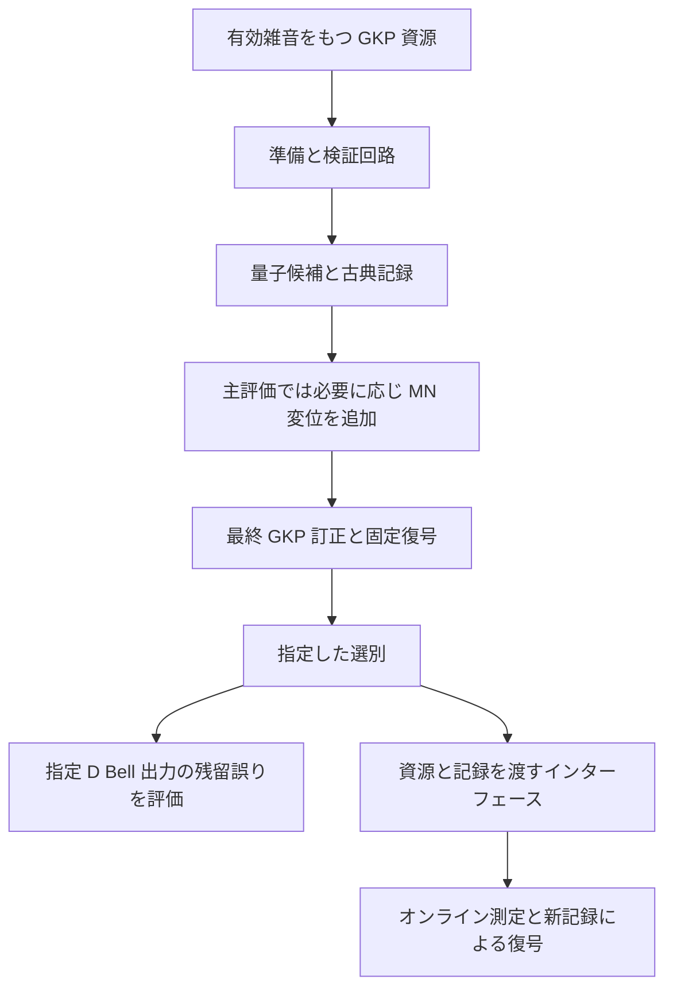

# 論文の図と主張を読み直す

前：[[15_資源数と時間の見積もり]]　案内：[[00_学習案内]]　復習：[[付録B_演習と解答]]

## 一つの資源が出力されるまで

ここまでの各章を、論文の処理順に戻してつなぐ。
工場は有効変位雑音をもつ GKP 資源から Bell 候補を作り、有限スクイージング QND 操作と検証測定を実行する。
各観測のアナログ情報と C4 シンドロームを使い、既知フレームをそろえた論理クラススコアを作る。
上位では 12 子資源の記録と新しい検証記録を合わせる。

主な数値試験では、完成候補に必要な追加 MN 変位を加え、最終 GKP 訂正と固定論理復号を実行する。
所定の保持方針で候補を選び、指定 $D$ Bell 出力に非恒等残留 Pauli があるかを数える。
独立確認の $15.6$ dB、レベル 2 は全候補保持である。

最後のオンライン処理は論文が仕様と理想構成を示す部分であり、図の流れ全体について一つの数値ゲート保証を得たわけではない。
主評価の MN ステップも、オンライン測定回路全体の代用と認定されたものではない。

## 図の読み方

| 原論文の図 | 読み取る対象 | 教材 |
|---|---|---|
| 図 1 | 工場とオンライン処理の分離、並列幅 | [[12_工場プロセッサ境界]] |
| 図 2 | QRL と注入、対応物理位置 | [[09_MBQCとQRL]] |
| 図 3 | レベル 1 と 12 子の再帰準備 | [[10_再帰工場とソフト復号]] |
| 図 4 | $12.25$ dB のレベル順序 | [[14_数値結果と統計的保証]] |
| 図 5 | 固定方針の雑音依存性と疎なレベル 5 点 | 本節下部 |
| 図 6 | 記録更新と独立評価の分離 | [[11_選別と独立評価]] |
| 図 7 | 評価グリッド上の順序確率 | [[14_数値結果と統計的保証]] |
| 図 8 | 補助的な尾部診断 | [[14_数値結果と統計的保証]] |
| 図 9 | 条件の異なる C4 運転点の上限 | [[15_資源数と時間の見積もり]] |

### 図 5 の疎な点

![[assets/fig5.png]]

レベル 2〜4 の区間と、レベル 5 の別サンプルによる支持点を区別する。
$11.75$ dB のレベル 5 は各条件 $0/2500$、$12.00$ dB は off が $0/200000$、on が $5/200000$ である。
$12.25$ dB の独立順序試験は図 4 に置かれている。
レベル 5 の疎な点を滑らかに結んで、未評価領域の閾値や尾部誤り率を推測する根拠にはしない。

### 図 6 の情報経路

![[assets/fig6.png]]

観測可能記録からクラスを推定する経路と、正解ラベルで評価する経路を分けて読む。
復号器が真の変位や真の誤りを直接知っている構成ではない。
試験用正解を使って後から保持方針を選び直すことも、独立確認の手順には含まれない。

### 図 7 の基準

![[assets/fig7.png]]

縦軸は誤り率ではなく、仮定した事後分布のもとでの厳密順序の確率である。
横軸の $12.125$ と $12.25$ の間を塗っても、連続物理閾値を測定したことにはならない。

### 図 8 の参照線

![[assets/fig8.png]]

この図は適応的停止を含む診断である。
ゼロ失敗点の上端は中央 $95\%$ Jeffreys 区間の上端であり、主確認の片側 CP 上限とは違う。
$10^{-7}$ の線は目標スケールを示す参照であって、達成値ではない。

### 図 9 の運転点

![[assets/fig9.png]]

横軸は有効 GKP 雑音品質であり、実際の光源から測定したスクイージングではない。
点ごとに連接レベル、保持率、統計方式が違うため、同じ実験条件の連続曲線として読まない。
他方式との公平な費用比較を表す図でもない。

## 主張と根拠を対応させる

| 論文の主張 | 根拠 | 適用条件 |
|---|---|---|
| 工場と共通 Gaussian 処理器を接続する仕様を定義 | 六項目のインターフェース、アドレスとフレーム規則 | 符号ごとに測定・制御規則を具体化 |
| C4 の論理 Clifford 構成を与える | 論理 Pauli の写像と QRL パターン | 置換と副作用を追跡 |
| $12.25$ dB でレベル 2〜5 の改善を支持 | 固定方針の独立評価と事後順序 | 有限レベル、宣言した統計モデル |
| $15.6$ dB、レベル 2 で $10^{-5}$ を個別に満たす | 各 100 万試行、CP 上限 | 指定変位モデル、固定復号器、二項仮定 |
| 保護オンライン深さをレベルによらず保つ | 並列な固定長構成 | 事前資源、並列容量、アドレス保存 |
| 高品質入力で名目 GKP 消費数を減らせる | $3637.9/288\simeq12.63$ | 異品質、異統計規約、名目計数 |

## 論文だけではまだ決まらないもの

光源の実測 GKP 品質、状態生成成功率、光損失、検出効率、モード不整合、記憶中の劣化を含めるには、その機器の模型が要る。
オンラインゲート全体の誤りには、注入、測定、条件付き補正を含むチャネルを評価する必要がある。
魔法状態工場と非 Clifford 操作の費用は、主な資源計数から外れている。

アルゴリズム全体については、論理ゲート数、許容失敗率、refresh の頻度、魔法状態消費、バッファ、並行処理を指定する。
教材の一般的な補足として、各操作の失敗事象を $E_j$ とすると、独立性を仮定しなくても

$$
\Pr\left(\bigcup_jE_j\right)\le\sum_j\Pr(E_j)
$$

という和の上界がある。
ただし本論文の Bell 資源誤りを、未評価の全ゲートの $\Pr(E_j)$ にそのまま代入することはできない。
資源誤りとオンラインの総合誤りを分ける理由は、ここでも同じである。

## 原論文へ戻る順序

まず第 II 節の GKP と C4 の規約を確認し、第 IV 節の工場と付録 B、D の復号を読む。
次に第 VI 節と付録 E の数値評価を、試行単位と統計方式に注意して読む。
最後に第 III、V 節と付録 F のインターフェースとオンライン構成へ戻ると、数値評価とアーキテクチャの主張を分けて追える。
Introduction と結論は、この対応関係を確認してから読むと省略された条件を補いやすい。

到達度の確認：[[付録B_演習と解答]]
